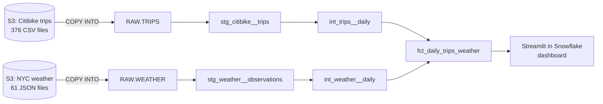

# Citibike × NYC Weather

How does weather affect Citibike usage in New York City? This repo is an end-to-end ELT pipeline
(Snowflake + dbt Cloud) that combines 61 million Citibike trips with NYC weather readings, and a
Streamlit dashboard that answers the question.

Built as the technical case study for DataEngine. The full build log, including what went wrong
and why each decision was made, is in [`project_development_journal.md`](project_development_journal.md).

## Findings

| | |
| --- | --- |
| **The season matters most** | A summer day has more than twice as many trips as a winter day. Temperature has by far the strongest correlation with daily trips (r ≈ 0.73). |
| **Weather matters on top of that** | Compared with dry days in the same season and day type, rain days have ~15% fewer trips and snow days ~40% fewer. |
| **How long it rains matters** | 1-2 rainy hours: ~10% fewer trips. 6+ rainy hours: ~25% fewer. |
| **Casual riders are the most weather-sensitive** | Rain: casual ~20% fewer vs members ~15%. Snow: casual ~70% fewer vs members ~40%. |

"Like-for-like" means every rainy or snowy day is compared only with dry days from the same season
and the same day type (weekday or weekend), so the season isn't mistaken for the weather.

## Architecture

| Stage | Tool | Where |
| --- | --- | --- |
| Extract + Load | Snowflake external stages + `COPY INTO` | [`setup/`](setup) |
| Transform | dbt Cloud (staging → intermediate → marts) | [`dbt/`](dbt) |
| Present | Streamlit in Snowflake (Power BI replaced, with approval) | [`Citibike Weather Dashboard/`](Citibike%20Weather%20Dashboard) |
| Investigation | Ad-hoc SQL used to make the decisions below | [`exploration/`](exploration) |

### dbt layers

| Layer | Model | What it does | Built as |
| --- | --- | --- | --- |
| staging | `stg_citibike__trips` | Types the raw text columns, adds a trip ID (bike + start time), flags trips over 24h, renames rider types to member / casual | table (61M rows; a view re-ran the dedupe on every read) |
| staging | `stg_weather__observations` | Unpacks the JSON, filters to NYC, Kelvin → °C, UTC → New York time, rain/snow flags, removes duplicate readings | view |
| intermediate | `int_trips__daily` | Trips per day, members vs casual, average trip length | view |
| intermediate | `int_weather__daily` | Weather per day, rainy/snowy hours between 06:00 and 22:00, day condition (Dry / Rain / Snow) | view |
| marts | `fct_daily_trips_weather` | One row per day with trips, weather and calendar fields. The inner join keeps only days with both sources (721 days, Jul 2016 to Jun 2018) | table |

The staging and mart models are tested (unique / not null keys, accepted values, accepted ranges).

### CI/CD

- **CI:** every pull request runs a dbt Cloud job that builds and tests the changed models
  (`dbt build --select state:modified+`) in a temporary schema. The result shows as a check on the PR.
- **CD:** merging into `main` triggers a job that rebuilds the changed models and everything
  downstream in production, deferring to production for the rest.
- `main` is protected in dbt Cloud, so all changes go through a branch and a pull request.

### Security

- Separate roles for separate jobs: `SYSADMIN` builds objects, `SECURITYADMIN` manages access,
  `TRANSFORMER` is dbt's role (read-only on `RAW`, can create its own schemas).
- dbt connects as a service user (`DBT_SVC`) with key-pair authentication. No passwords; private
  keys live only in dbt Cloud and are never committed.
- Snowflake ↔ GitHub uses an API integration with OAuth, limited to this GitHub account.

## Data quality decisions

| Found | Decision |
| --- | --- |
| Weather mixes two locations: NYC (city id 5128581) and a point in upstate New York (5128638) | Filter to NYC by city id, not by coordinates |
| 27% of NYC weather readings are exact duplicates in the source | Keep one copy per reading (`qualify row_number()`) |
| Temperature in Kelvin, time as a UTC epoch | Convert to °C and to `America/New_York` (handles daylight saving) |
| Rain amount missing on two-thirds of rain-labelled readings, in mixed 1h / 3h windows | Define rain by the weather label; keep amount only as mm/hour where present, missing = NULL not 0 |
| 19 trips where one bike starts two trips at the same moment (double-logged returns) | Trip ID = bike + start time; keep the first recorded |
| 13,535 trips over 24 hours (lost bikes / errors) | Keep them as trips, flag them, exclude from average trip length |
| 5 days with no weather readings at all | Excluded by the join rather than guessed |

## Assumptions and limits

- This shows correlation, not cause. Holidays and special events aren't controlled for.
- "Season" bundles temperature, daylight and tourism together; this data can't separate them.
- A **rainy hour** is a reading labelled Rain, Drizzle or Thunderstorm. A **rainy day** has at least
  one rainy hour between 06:00 and 22:00, when people actually ride.
- "Dry" means no rain or snow, not necessarily sunny: it includes cloudy days.
- Analysis window is July 2016 to June 2018, the only period both sources cover.

## Rebuilding from scratch

1. **Snowflake:** run the files in [`setup/`](setup) in order (`00` → `06`).
   - `00` needs `ACCOUNTADMIN` (it creates the GitHub integration).
   - After `05`, generate a key pair locally and set the public key on `DBT_SVC` (the command is in
     a comment at the bottom of `05`). The private key goes into dbt Cloud only.
2. **dbt Cloud:** create a project with subdirectory `dbt/`, connect it to Snowflake as `DBT_SVC`
   (role `TRANSFORMER`, database `CITIBIKE`, warehouse `CITIBIKE_WH`) and to this repo. Run
   `dbt deps`, then `dbt build`.
3. **Production:** create a Production environment (schema `ANALYTICS`), a merge job and a CI job
   as described above.
4. **Dashboard:** create a Streamlit app in `CITIBIKE.APPS` and paste in `streamlit_app.py`. It
   reads `CITIBIKE.ANALYTICS_MARTS.FCT_DAILY_TRIPS_WEATHER`.

## Future work

- An hourly mart (trips per hour × weather per hour) to look at rain during commute hours.
- US public holidays as a dbt seed, so they can be controlled for.
- A regression model that separates temperature, rain and day type.
- Deploy the dashboard from the Git repo so it gets the same CI/CD as dbt.
- A separate CI environment and service user, and a read-only reporting role for the dashboard.
- Extend to the newer (2019+) Citibike data with a matching weather source.
